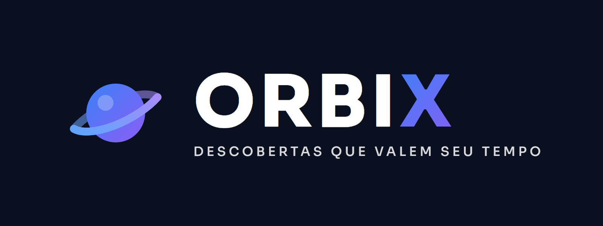
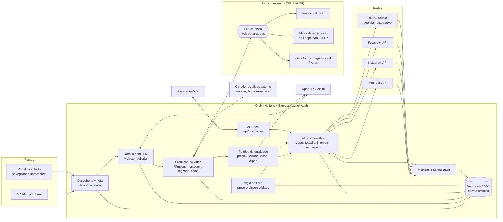

# Orbix: fábrica de vídeos curtos que roda sozinha

> **English summary.** Orbix is a self-running Node.js/Express system I built solo (pair-programming with Claude Code).
> It discovers affiliate products, writes scripts with LLMs, generates short vertical videos with an AI presenter
> (an alien character called "Lila"), runs automated quality gates (price confirmation, vision checks, scheduling
> rules) and schedules/publishes them to YouTube, Instagram, Facebook and TikTok through an autopilot.
> Heavy GPU work is coordinated across several local apps by a file-based inter-process lock.
> The private codebase has **622 test suites** (`tests/*.test.js`, run by a custom runner).
> **This repository is a showcase**: the full source is private; here you find the architecture, real code excerpts
> and real tests (`node --test amostras/*.test.js`).

---

## O problema

Um canal de achadinhos (afiliado) precisa de volume: achar produto bom, escrever roteiro, gravar, editar, conferir
preço, escolher horário e postar em quatro redes, todo dia. Feito à mão, isso consome o dia inteiro de uma pessoa, e
os erros mais caros são silenciosos: preço errado no vídeo, oferta que acabou antes do post, mesmo produto repetido,
dois processos brigando pela placa de vídeo no meio da madrugada.

## O que o sistema faz

- **Descobre produtos** em marketplaces (API oficial do Mercado Livre; Shopee pelo portal de afiliado com navegador
  automatizado) e dá uma nota explicável de oportunidade (sinal ausente nunca vira zero; pouco dado nunca vira
  confiança alta).
- **Escreve o roteiro** com LLM (OpenAI e Gemini), com um diretor editorial determinístico por cima: só fatos do
  cadastro, sem inventar preço, benefício ou avaliação.
- **Gera o vídeo** com a apresentadora de IA: falas com voz neural local, cenas por um motor de vídeo local
  (aplicativo separado, chamado só por HTTP) e clipes de um gerador externo operado por automação de navegador;
  montagem, legenda, selos e preço com FFmpeg.
- **Confere antes de sair**: preço confirmado por duas leituras antes de gravar, checagem visual das imagens geradas,
  conferência de clipes, regras de agenda.
- **Agenda e publica sozinho** (piloto automático): cotas semanais por tipo de vídeo, teto por dia e por rede,
  intervalo mínimo entre posts, dias sem repetir produto. YouTube, Instagram e Facebook por API; TikTok pelo
  agendamento nativo do TikTok Studio, via automação de navegador.
- **Vigia depois de agendado**: o vigia de links confere preço e disponibilidade; se a oferta acabou ou o preço subiu
  mais de 10%, o vídeo marcado lá na frente é desmarcado sozinho, com motivo registrado.
- **Aprende com os números**: coleta de métricas por publicação, mediana por tipo de vídeo e ajuste de cotas
  (ex.: a cota semanal de um formato sobe ou desce de 1 em 1 conforme views e cliques medianos).
- **Conversa por um assistente** externo ("Orbit") que lê um resumo e executa ações de uma **lista fechada** exposta
  em HTTP local; nada de comando livre.

## Arquitetura

## Tecnologias (só o que está de fato no projeto)

| Camada | O que é usado |
| --- | --- |
| Servidor e painel | Node.js, Express, multer, dotenv, uuid; front-end em HTML/CSS/JS puro |
| LLM | SDK `openai` (roteiro, conferência visual) e `@google/generative-ai` |
| Vídeo e áudio | FFmpeg via `fluent-ffmpeg`, `ffmpeg-static`, `ffprobe-static`; `edge-tts-universal`; voz neural local e transcrição em Python |
| Automação de navegador | Puppeteer (portal de afiliado, TikTok Studio, gerador de clipes) |
| Integrações | YouTube Data API, Instagram e Facebook Graph API, API do Mercado Livre, Telegram Bot API |
| Testes | `node:test` + `node:assert/strict`, mais um executador próprio (`tests/run-all.js`) |

## Como foi testado

Números contados no repositório privado em 18/10/2026:

- **622 suítes de teste** (`tests/*.test.js`). O executador `tests/run-all.js` roda cada arquivo **em um processo
  separado** (um teste que trava ou suja estado global não derruba os outros) e imprime `N/M suites passaram`.
- **367 arquivos `.js` em `src/`**, cerca de **118 mil linhas**.
- O executador cria uma pasta temporária para a fila da GPU antes de rodar, para que nenhum teste mexa na fila real
  que outros apps usam.

Regras que os testes seguem (e que viraram regra depois de um incidente real: um teste sem pasta própria herdou a
pasta de dados real e uma varredura apagou um arquivo de produção):

- **nunca a pasta `data/` real**: todo teste usa banco em memória ou `fs.mkdtempSync` e apaga no fim;
- **offline**: serviço montado com repositório em memória e dependências injetadas (`now`, `pidVivo`, `agora`,
  `logger`), sem rede;
- **casos de fronteira explícitos**: exatamente 10% não cancela e 12% cancela; 48 h exatas libera e 1 ms antes não;
- **dado ruim falha fechado**: leitura suspeita, velha, de outra moeda ou ausente nunca dispara ação destrutiva.

Para este repositório rodei só as suítes das amostras (puras, sem rede e sem disco real), não a bateria completa:

| Suíte (original) | Resultado |
| --- | --- |
| `affiliate-preco-para-gravar.test.js` | 6 de 6 passaram |
| `affiliate-desmarcar-por-oferta.test.js` | 7 de 7 passaram |
| `affiliate-automatic-same-product-gap.test.js` | 4 de 4 passaram |
| `fila-da-placa-vez-viva.test.js` | passou (script com `assert`, pasta temporária) |

Nas amostras daqui: `node --test amostras/*.test.js` roda 11 testes (11 passando no Node 24).

## Amostras de código (`amostras/`)

Trechos reais, recortados e sem dados sensíveis. Cada arquivo diz de onde veio e o que mostra.

| Arquivo | O que mostra |
| --- | --- |
| `fila-da-placa.trecho.js` | Lock entre processos e entre apps por arquivos: criação exclusiva (`wx`), escrita atômica (tmp + rename), FIFO, pid morto libera, "livre duas vezes seguidas" contra condição de corrida, detecção de vez perdida |
| `preco-para-gravar.js` + `.test.js` | Portão de qualidade: o preço precisa de 2 leituras que batem (5%) antes de gastar GPU gravando |
| `desmarcar-por-oferta.js` + `.test.js` | Desmarcar post agendado só com prova (oferta acabou, indisponível, preço +10%) |
| `intervalo-mesmo-produto.js` | Regra de cadência do agendador: N dias entre vídeos do mesmo produto, devolvendo o próximo horário válido |
| `video-products.js` | Normalização dos ids de produto de um vídeo (usada pelas duas regras acima) |

## Decisões de engenharia interessantes

- **Falhar fechado em tudo que é irreversível.** Cancelar post, apagar arquivo, publicar: só com prova. Falha de
  leitura é "não sei", nunca "pode".
- **Validação antes do custo, não depois.** Conferir preço e foto antes de gravar custa uma consulta; descobrir
  depois custa GPU, créditos de geração e um vídeo refeito.
- **Coordenação sem servidor.** Vários apps locais disputam uma GPU de 16 GB. Em vez de um daemon central, um
  protocolo de arquivos que qualquer app segue, com expiração por pid e por renovação, teto de espera e um diário
  (`uso.jsonl`) para medir quem esperou quanto. Cada regra nova nasceu de um incidente medido (dois apps na GPU de
  madrugada; vez "abandonada" com o PC paginando).
- **Ações fechadas para o assistente.** O assistente de chat não executa código livre: chama uma lista fechada de
  ações expostas pela API local, cada uma com validação própria.
- **Tudo automático, chave só para testar.** Recurso novo que publica nasce desligado; depois de aprovado, roda
  sozinho. O agendamento sempre passa pelo piloto, que aplica teto por rede e intervalo.
- **Injeção de dependência para testabilidade.** Relógio, verificação de pid, logger e repositório entram por
  parâmetro; é isso que permite testar fronteiras de tempo sem esperar e sem tocar em disco real.

## Limitações e status (honesto)

- Projeto pessoal em produção na minha máquina, desenvolvido sozinho com o Claude Code como par de programação.
- Roda em um único PC Windows com GPU; o PC precisa estar ligado nos horários de produção e envio.
- Parte das integrações depende de automação de navegador (TikTok Studio, portal de afiliado, gerador de clipes):
  quando a interface muda, quebra, e logins/captchas são resolvidos por uma pessoa, de propósito.
- Banco em arquivos JSON, adequado para um usuário só; não é um sistema multiusuário.
- Nem todas as 622 suítes foram executadas para este repositório; os números de aprovação acima se limitam às
  suítes listadas.

## Sobre este repositório

O código completo é **privado** (contém credenciais, contas e dados de produção). Este repositório é uma vitrine:
arquitetura, trechos reais e testes reais. Os nomes no código estão em português porque o sistema foi escrito para
uso próprio.

**Autor:** Erinaldo Gomes ([@erinaldogomes](https://github.com/erinaldogomes)), Análise e Desenvolvimento de Sistemas,
fundador da [ClickGo](https://clickgo.dev.br).
Construo sistemas que rodam sozinhos usando IA e estou migrando para QA e automação de testes.

## Licença

Todos os direitos reservados. O código está aqui só para leitura e avaliação; não é permitido copiar, usar ou redistribuir sem autorização do autor.

